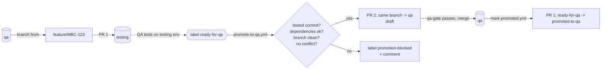

# label-based-promotion

Working example for **MBC-3938** (Spike: Evaluate a testing + qa two-branch model with label-based PR promotion).

The app is a small to-do list CLI (`src/`). It exists only so that demo PRs change real code. The subject of the example is `.github/`.

## The model

- `testing` is the integration branch. It accepts untested PRs.
- `qa` is the stable branch. It accepts only PRs that passed testing.
- Each feature branch starts from `qa`. It merges into `testing` first (PR 1). After the test, the **same branch** merges into `qa` (PR 2, opened by automation).
- **Rule: never merge `testing` into a feature branch.** A required check enforces it.



## Labels

| Label | Color | Meaning | Who adds it |
|---|---|---|---|
| `depends-on-pr` | `#FBCA04` | This PR needs another PR. The body has `Depends on: #N`. | Automation (from the body) |
| `is-dependency` | `#C5DEF5` | Another PR needs this PR. | Automation |
| `ready-for-qa` | `#0E8A16` | Testing passed. Promote this PR to qa. | QA / developer |
| `promoted-to-qa` | `#5319E7` | The change is in qa. | Automation only |
| `promotion-blocked` | `#B60205` | Automation could not promote. The PR comment has the reason. | Automation |

## Files

| File | Job |
|---|---|
| `.github/workflows/promote-to-qa.yml` | On `ready-for-qa` added to a PR merged into `testing`: check the branch tip is the tested commit, check dependencies, check the branch is clean, check for conflicts with `qa`, open the draft promotion PR. On failure: add `promotion-blocked` and comment with the reason. |
| `.github/workflows/mark-promoted.yml` | On a PR merged into `qa`: find the testing PR with the same head commit, remove `ready-for-qa`, add `promoted-to-qa`. |
| `.github/workflows/dependency-labels.yml` | On PR open or edit: sync `depends-on-pr` / `is-dependency` from `Depends on:` lines. |
| `.github/workflows/guardrail.yml` | Required checks: `no-testing-merge` (PRs into `testing` and `qa`) and `qa-gate` (PRs into `qa`). |
| `.github/workflows/tests.yml` | App tests (`app`) and script tests (`scripts`). |
| `.github/scripts/*.sh` | The logic. Plain bash + `gh` + `jq`, so it can be tested and reused outside Actions. |
| `scripts/setup-repo.sh` | One-time setup: labels, branches, repo settings, branch protection, merge-method ruleset. |
| `tests/*.test.sh` | Script tests. The guardrail tests build a throwaway git repo. The gate tests use a stub `gh`. |

## How the checks work

**qa gate** (`check-qa-gate.sh`, required on every PR into `qa`). It does not trust the PR body. It looks up the merged PR into `testing` from the same branch **with the same head commit**, and passes only when:

1. that PR exists (so commits pushed after PR 1 merged, or a PR that never went through `testing`, fail),
2. it has `ready-for-qa` or `promoted-to-qa`,
3. every `Depends on:` PR of it is already `promoted-to-qa`.

**Dependency gate** (`check-dependencies.sh`). For each `Depends on: #N` PR:

| Dependency label | When `ready-for-qa` is added | On the qa PR (`qa-gate`) |
|---|---|---|
| `promoted-to-qa` | pass | pass |
| `ready-for-qa` | pass. The promotion PR body says to merge the dependency first. | fail until the dependency is in qa |
| other / not found | block | fail |

Only the leading `#N` list after `Depends on:` counts. A line with no `#N` (for example a URL) gives a warning. Dependent branches must start from the dependency branch (stacked), not from `testing`.

**Guardrail** (`check-branch-clean.sh`). A commit "came from testing" when it is on the first-parent chain of `testing` and not in `qa`. Every PR merge into `testing` adds a merge commit to that chain (merge commits only, see the `merge-commit-only` finding). A feature branch's own commits enter `testing` only as the second parent of a merge commit, so they are never on the chain. If a branch merges `testing`, or starts from it, the tip of `testing` becomes reachable from the branch, and the check fails. Merging `qa` into a branch stays allowed. `resolve/*` branches into `testing` are exempt (see conflicts below); they can never reach `qa`, because `no-testing-merge` on the `qa` PR and the clean check in `promote-to-qa` still apply to them.

**Conflict check** (`check-mergeable.sh`). `git merge-tree` test-merges the branch into `qa` without a working tree. On a conflict, the promotion is blocked and the comment lists the files. To fix: merge `qa` into the branch, fix, push, open a new PR into `testing`, and add `ready-for-qa` to the new PR after it is tested. The old PR keeps `ready-for-qa` and `promotion-blocked`; remove them by hand.

## Try it

```bash
npm test                     # app tests
bash tests/run.sh            # script tests
scripts/setup-repo.sh        # labels, qa + testing branches, settings, protection
```

Walk-through on GitHub:

1. `git switch -c feature/MBC-1-due-dates origin/qa`, change `src/todo-list.js`, push, open PR 1 into `testing`, merge it.
2. Add `ready-for-qa` to PR 1. `Promote to qa` opens a draft PR 2 from the same branch into `qa`.
3. Mark PR 2 "Ready for review". The required checks run. Merge PR 2.
4. PR 1 now has `promoted-to-qa`.

Failure demos:

- **Dependency.** Open PR 3 from a branch stacked on an untested branch, with `Depends on: #<that PR>` in the body. Merge into `testing` and add `ready-for-qa`. Result: `promotion-blocked` and a comment.
- **Guardrail.** On a feature branch, run `git merge origin/testing` and push. `no-testing-merge` fails on the PR.
- **Untested commit.** After PR 1 merges, push one more commit to the branch and add `ready-for-qa`. Result: blocked.

Retry after a fix: remove `ready-for-qa` and add it again.

## Demo results (2026-10-15)

Run on this repo with `scripts/setup-repo.sh` and real PRs, with `actions/checkout@v4` and `actions/setup-node@v4`. Scenarios A to D ran. The gates worked as designed; the surprises are listed under "Found in the demo". The untested-commit demo was not run.

| Scenario | PRs | Result |
|---|---|---|
| A. Normal path | #1 -> `testing`, #2 -> `qa` | `ready-for-qa` on #1 opened draft #2 from the same branch. After #2 merged, #1 got `promoted-to-qa`. |
| B + C. Dependency | #3 (B), #4 (C, stacked on B, `Depends on: #3`), #5, #6 | `ready-for-qa` on #4 while #3 was untested: blocked with a comment. `ready-for-qa` on #3 opened #5. A retry on #4 opened #6. #6 failed `qa-gate`, and branch protection refused the merge. #5 merged and #3 got `promoted-to-qa`. `qa-gate` on #6 did not re-run by itself; after `gh run rerun --failed` it passed, #6 merged, and #4 got `promoted-to-qa`. |
| D. Guardrail | #7 | The branch merged `testing`. `no-testing-merge` failed and listed the 2 `testing` merge commits. Left open as the failure example. |

Verified GitHub behaviors:

- `pull_request_target` with `labeled` starts on a merged PR.
- A `::warning::` that a script writes to stderr shows as an annotation.
- GitHub marks a PR as merged when another PR brings its head commit into the base. #3 shows "merged" (and still draft) because #4, stacked on it, merged into `testing`.

## Findings for the spike

Setup and platform:

- **GITHUB_TOKEN does not start other workflows.** A promotion PR that `GITHUB_TOKEN` opens gets no new check results (see "Bot-opened PRs make empty failed runs"). This example opens it as a draft, and "Ready for review" by a person starts the checks. To run them at once, add a `PROMOTION_TOKEN` secret (GitHub App token preferred). The workflow uses it when it exists.
- **"Allow GitHub Actions to create and approve pull requests"** must be on. The setup script does it.
- **Merge commits only into `testing` and `qa`.** With "Create a merge commit", the feature commits have the same SHAs in both branches. Only the merge commits differ, and only `resolve/*` merges add changes, so stacked and later branches merge cleanly into `testing`. `testing` does not need an update from `qa`, because `qa-gate` lets into `qa` only commits that are already in `testing` (admins can bypass required checks, because `enforce_admins` is off). A squash or rebase merge makes copies of the feature commits. Git then does not see that a stacked or later branch already contains them, and the merge conflicts (`tests/merge-method.test.sh` shows the stacked and the later-branch case). The setup script adds the ruleset `merge-commit-only` (`allowed_merge_methods: [merge]`) for `testing` and `qa`. Keep "Allow merge commits" on in the repo settings, or the ruleset blocks every merge.
- **"Automatically delete head branches"** must be off. Otherwise the branch is gone before PR 2. The workflow blocks with a clear message if this happens.
- **`pull_request_target`** is used for the label workflows, so the YAML comes from the current base branch and not from an old merged PR. They check out that same base commit, so the YAML and the scripts always match. They read PR data only and never run PR code.
- **Workflow changes must flow like code.** The label workflows run the copy on `testing` or `qa`, and the guardrail runs scripts from `main`. A change to `.github/` must reach `main`, `qa` and `testing` before it is fully live.

Limits of the guardrail:

- **It stops mistakes, not misuse.** The required checks use `pull_request`, because a required check must report on the PR head commit. So a PR can edit its own copy of `guardrail.yml` to pass. The check scripts come from the default branch, but the YAML does not. For identity, protect `.github/` with CODEOWNERS and code-owner review, or use an org ruleset "Require workflows to pass" from a central repo.
- **Conflicts with `testing`.** `testing` collects many untested PRs, so PR 1 often has conflicts. GitHub's "Resolve conflicts" and "Update branch" buttons merge `testing` into the feature branch, and the guardrail then blocks the branch. The spike says: fix the conflict in a merge commit on `testing`, never in the feature branch. On GitHub, that needs a short-lived branch from `testing` named `resolve/<ticket>` that merges the feature branch and fixes the conflict, merged into `testing` by its own PR. The guardrail exempts `resolve/*` into `testing`. The exemption is by branch name only, so any developer can use it to land a `testing` merge in `testing` (not in `qa`). If identity needs more control, a ruleset can limit who can push `resolve/*` refs. PR 1 then shows as merged when its head commit reaches `testing` (verified in the demo, see #3). Measure how often this happens before go / no-go.
- **A sprint reset of `testing` forgives old mistakes.** A branch that merged the old `testing` passes after the reset. The old untested commits are then "not in testing", so the rule no longer sees them. Reset only when no such branch is open.
- **Fast-forward pushes to `testing`** (outside a PR) would put feature commits on the first-parent chain and cause false positives. The setup script requires a PR for `testing` and `qa`. The sprint reset of `testing` is a manual repo-admin push. The `merge-commit-only` ruleset has no bypass actors, so it blocks that push too. Reset procedure: `id=$(gh api --paginate "repos/<owner>/<repo>/rulesets?includes_parents=false" --jq '.[] | select(.source_type=="Repository" and .name=="merge-commit-only") | .id' | head -n1)`, then `gh api -X PUT repos/<owner>/<repo>/rulesets/$id -f enforcement=disabled`, then `git push --force-with-lease origin origin/qa:testing`, then the same `gh api` call with `enforcement=active`. Always run the `enforcement=active` step, also when the push fails. While the ruleset is off, anyone can squash-merge into `testing` or `qa`.

Found in the demo:

- **Merging a stacked PR also merges its dependency.** B reached `testing` without its own merge decision, while it was still a draft (see "Verified GitHub behaviors"). Decide with the team: accept this, or require that the dependency PR merges into `testing` first.
- **Check results carry over to the promotion PR.** The promotion PR has the same head commit as PR 1. Before "Ready for review", it already shows the `app` and `no-testing-merge` results of PR 1, and only `qa-gate` is missing. "Ready for review" re-runs all checks. This makes `qa-gate` the most important required check, and it is the only one that the `GITHUB_TOKEN` limit really delays.
- **Bot-opened PRs make empty failed runs.** When `GITHUB_TOKEN` opened #2, #5 and #6, GitHub made Tests and Guardrail runs as `github-actions[bot]` with no jobs. GitHub reports them as a likely "workflow file issue". They do not show in the PR checks, but they show as red runs in the Actions tab. The cause is not confirmed. A `PROMOTION_TOKEN` (GitHub App) would probably avoid them; verify.
- **Use a current `gh`.** gh 2.45 (Ubuntu apt) fails on `gh pr edit` with "Projects (classic) is being deprecated". The runner's gh works. For local use, install gh from GitHub's own package repository.
- **Keep actions current.** `actions/checkout@v4` and `actions/setup-node@v4` gave Node 20 deprecation warnings. This repo now uses `@v5` (node24), which has not had a full demo run yet. Newer majors exist (checkout v7.0.1, setup-node v7.1.0). Checkout v5.1.0 and later block fork-PR checkout in `pull_request_target`. This repo checks out only the base commit there, so it is not affected. Read the release notes before moving identity to v7.

Other limits:

- **`qa-gate` does not re-run** when a dependency is promoted later (seen in the demo). Re-run it with `gh run rerun <run-id> --failed`. A follow-up could re-trigger dependents from `mark-promoted.yml`.
- **`is-dependency` is not removed** when a `Depends on:` line is deleted, because another PR may still depend on it.
- **`promoted-to-qa` added by hand** is not prevented. A person who adds it to a dependency gets past the dependency gate.
- **Fork PRs** are out of scope. The workflows assume same-repo branches (true for identity).
- **Off-the-shelf backport actions** (for example `korthout/backport-action`) cherry-pick commits onto a new branch. This model reuses the original branch, so a small `gh` script fits better.
